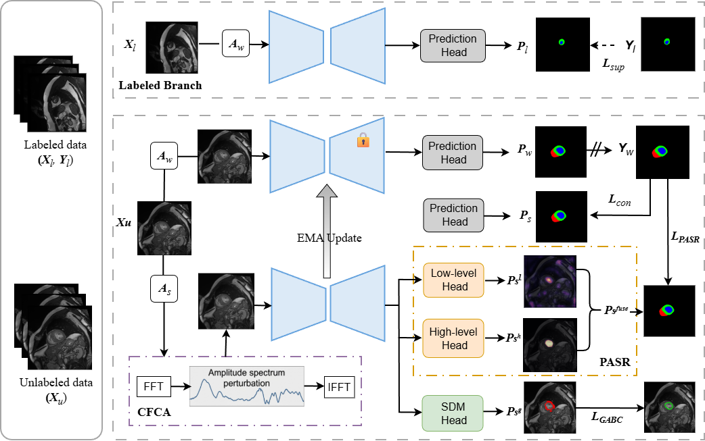

<div align="center">
<h1>MSCP-Net: A Multi-Source Calibrated Prior Network for Semi-Supervised Medical Image Segmentation</h1>

</div>

## Abstract
Semi-supervised medical image segmentation (SSMIS) aims to leverage abundant unlabeled images together with limited pixel-wise annotations, and weak-strong consistency learning has become its de facto standard. Nevertheless, existing frameworks still suffer from three limitations. First, multi-scale decoder outputs are usually fused with static weights, ignoring the spatially varying reliability of low-level and high-level predictions across pixels. Second, data augmentation is confined to the spatial domain and cannot faithfully simulate the intensity and appearance shifts introduced by different clinical scanners. Third, pixel-level consistency losses neglect geometric boundary priors, which tends to produce blurred contours, especially for small or thin anatomical structures. To address these issues, we propose MSCP-Net, a multi-source calibrated prior network. It integrates three complementary modules: the Pixel-Aware Scale Reconciliation (PASR) module dynamically reconciles multi-scale predictions with pixel-wise confidence; the Clinical Frequency Calibration Augmentation (CFCA) module perturbs the low-frequency magnitude spectrum to simulate clinical intensity variations; and the Geometry-Anchored Boundary Consistency (GABC) module introduces signed distance maps as geometric priors to sharpen boundaries. Extensive experiments on ACDC and Synapse demonstrate that MSCP-Net achieves competitive or superior performance against state-of-the-art methods under limited-annotation settings.

## Overview
We propose a multi-source calibrated prior network for semi-supervised medical image segmentation. The method addresses multi-scale static fusion, domain shift in appearance, and blurred boundary contours.



## Main Results

### Synapse Multi-Organ Dataset
| Method | Labeled | DSC ↑ | ASD ↓ | Aorta | GB | KL | KR | Liver | PC | SP | SM |
|--------|---------|-------|-------|-------|----|----|----|----|----|----|-----|
| **MSCP-Net** | 1 (5%) | **67.58** | **17.90** | **84.66** | 39.04 | 75.05 | **73.89** | **90.77** | **42.68** | **81.20** | **53.31** |
| **MSCP-Net** | 4 (10%) | **69.67** | **12.91** | **82.37** | **48.18** | **76.69** | **80.73** | 90.97 | **41.88** | **86.52** | 50.03 |

### ACDC Cardiac Dataset
| Method | Labeled | DSC ↑ | ASD ↓ | Myo | LV | RV |
|--------|---------|-------|-------|-----|----|----|
| **MSCP-Net** | 3 (5%) | **88.65** | 0.88 | **87.40** | **86.66** | **91.90** |
| **MSCP-Net** | 7 (10%) | **90.45** | **0.47** | **89.95** | **87.70** | **93.69** |

## Installation

We recommend the following platforms:
```bash
Python 3.8+ / PyTorch 1.10+ / CUDA 11.0+